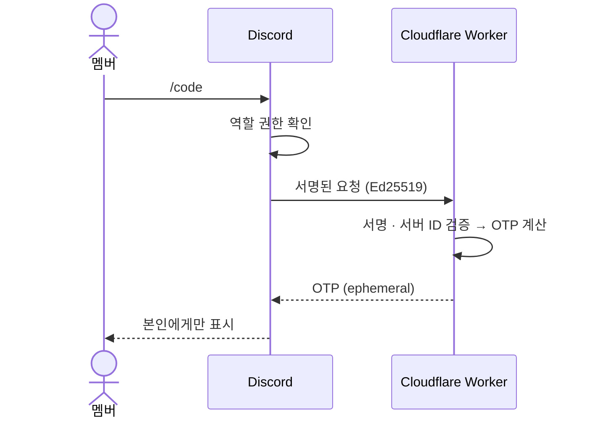

<div align="center">

# discord-otp-bot

**공유 계정의 2단계 인증, 디스코드 `/code` 한 번으로.**

계정 주인의 폰을 기다리지 않고 OTP 키를 나누지 않고 로그인하세요.

[](https://workers.cloudflare.com/)
[](https://discord.com/developers/applications)

[](LICENSE)

[처음 설치하기](#처음-설치하기) · [동작 방식](#동작-방식) · [멤버 안내](#멤버-안내-공지) · [문제 해결](#문제-해결)

</div>

---

공유 계정에 2단계 인증을 걸면 로그인할 때마다 계정 주인 폰으로 승인 요청이 갑니다. 이 봇을 쓰면 OTP 키는 봇만 갖고 있고 멤버는 디스코드에서 `/code`를 쳐서 현재 6자리 코드만 받습니다. 주인 폰 없이도 로그인할 수 있고 OTP 키를 나눠줄 필요도 없어요.

구글처럼 2단계 인증을 **인증 앱(Google Authenticator 등)** 방식으로 지원한다면 어떤 서비스든 쓸 수 있습니다.

## ✨ 특징

<table>
  <tr>
    <td width="50%" valign="top">
      <strong>🔐 OTP 키 비공개</strong><br />
      키는 Cloudflare Secret에만 저장돼요. 멤버에게는 현재 코드만 전달합니다.
    </td>
    <td width="50%" valign="top">
      <strong>👀 나만 보이는 응답</strong><br />
      요청한 사람에게만 코드를 표시하고 채팅 기록에는 남기지 않아요.
    </td>
  </tr>
  <tr>
    <td valign="top">
      <strong>🛡️ 서버·역할 제한</strong><br />
      지정한 서버의 허용된 역할만 사용할 수 있습니다. (비밀번호는 봇이 다루지 않아요.)
    </td>
    <td valign="top">
      <strong>☁️ 가볍게, 서버 없이</strong><br />
      의존성 0개, 코드 약 40줄로 Cloudflare Workers 무료 플랜에서 동작해요.
    </td>
  </tr>
</table>

## 동작 방식



---

## 처음 설치하기

**⏱️ 약 15분** · 아래 순서대로 진행하면 됩니다.

| 01 — 연결 준비 | 02 — 배포·연결 | 03 — 사용 설정 |
|---|---|---|
| 저장소 받기 → 디스코드 앱 만들기 | Worker 배포 → 엔드포인트 연결 → 앱 설치 | `/code` 등록 → OTP 키 등록 → 역할 제한 → 확인 |

> [!IMPORTANT]
> **3 → 4번 순서가 중요합니다.** Cloudflare에 `DISCORD_PUBLIC_KEY`를 먼저 등록한 뒤 디스코드 엔드포인트를 연결하세요.

### 준비물

- 디스코드 서버 (관리 권한 필요, 공유 전용 서버 추천)
- [Cloudflare](https://dash.cloudflare.com/sign-up) 계정 (무료)
- Node.js 18 이상
- 공유할 계정 (예: 공유 전용 구글 계정)과 내 폰의 인증 앱

### 1. 저장소 받기

```sh
git clone https://github.com/halfmoon-mind/discord-otp-bot.git
cd discord-otp-bot
npx wrangler login   # 브라우저에서 Cloudflare 로그인
```

### 2. 디스코드 앱 만들기

1. [Discord Developer Portal](https://discord.com/developers/applications) → **New Application**
2. **일반 정보(General Information)** 탭에서 두 값을 메모합니다.
   - `애플리케이션 ID` (APP_ID)
   - `퍼블릭 키` (PUBLIC_KEY)
3. 디스코드 앱 → 설정 → 고급 → **개발자 모드** 켜기 → 내 서버 아이콘 우클릭 → **서버 ID 복사** (GUILD_ID)

### 3. Cloudflare에 배포하고 키 넣기

```sh
npx wrangler deploy
# → https://<wrangler.toml의 name>.<내계정>.workers.dev 주소가 나옴. 메모하기

npx wrangler secret put DISCORD_PUBLIC_KEY   # 프롬프트에 PUBLIC_KEY 붙여넣기
npx wrangler secret put GUILD_ID             # 프롬프트에 GUILD_ID 붙여넣기
```

> [!TIP]
> Worker 이름(주소)은 `wrangler.toml`의 `name`으로 정해집니다. 배포한 뒤에 바꾸면 새 Worker가 생기니 처음에 정하세요.

### 4. 디스코드에 엔드포인트 연결

개발자 포털 → **일반 정보** → **인터랙션 엔드포인트 URL**에 3번 주소를 넣고 저장합니다.

> [!NOTE]
> 저장할 때 디스코드가 서명 테스트 요청을 보냅니다. 3번에서 `DISCORD_PUBLIC_KEY`를 먼저 넣어야 저장돼요.

### 5. 서버에 앱 설치

브라우저에서 아래 주소를 엽니다. `APP_ID`는 바꿔 넣으세요. 내 서버를 고르고 **승인**합니다.

```
https://discord.com/oauth2/authorize?client_id=APP_ID&scope=bot+applications.commands&permissions=0
```

### 6. `/code` 명령 등록

1. 개발자 포털 → **봇** → **토큰 초기화** → 복사
2. 바로 실행합니다 (macOS 기준, 토큰은 클립보드에서 바로 들어가 화면에 남지 않아요).

```sh
curl -X PUT "https://discord.com/api/v10/applications/APP_ID/guilds/GUILD_ID/commands" \
  -H "Authorization: Bot $(pbpaste)" -H "Content-Type: application/json" \
  -d '[{"name":"code","description":"공유 계정 로그인 OTP"}]'
```

3. 응답에 `"name":"code"`가 보이면 성공입니다. **토큰을 한 번 더 초기화**하고 복사하지 마세요. 봇 토큰은 이후 쓸 일이 없고 새면 채널 메시지가 읽힐 수 있어요.

> macOS가 아니면 `$(pbpaste)` 대신 토큰을 직접 붙여넣으세요.

### 7. 공유 계정에 OTP 등록 (구글 예시)

1. 공유 구글 계정 → [myaccount.google.com](https://myaccount.google.com) → 보안 → **2단계 인증** → **Authenticator 앱** 추가
2. QR 화면에서 **"스캔할 수 없나요?"** → 나오는 키를 복사
3. 같은 키를 **내 폰 인증 앱에도 수동 입력**합니다 (백업 겸 구글 설정 확인 코드용).
4. 봇에 넣습니다.

```sh
npx wrangler secret put TOTP_SECRET   # 프롬프트에 키 붙여넣기 (공백 섞여도 OK)
```

5. 클립보드를 비웁니다 (`pbcopy < /dev/null`).
6. 구글 2단계 인증 화면에서 **백업 코드**도 받아 안전한 곳에 보관하세요.

### 8. 허용된 사람만 쓰게 하기

1. 서버 설정 → **역할** → 역할 만들기 (예: `OTP 허용`) → 멤버 관리에서 사용할 사람 추가
2. 서버 설정 → **연동** → 내 앱 → 명령어 권한
   - `@everyone` → **거부**
   - `역할 또는 멤버를 추가하세요` → `OTP 허용` → **허용** → 저장

### 9. 확인

디스코드에서 `/code`를 칩니다. 나온 6자리가 **내 폰 인증 앱의 코드와 같으면** 설치 완료입니다.

> [!TIP]
> 설치를 마쳤다면 아래 [멤버 안내 공지](#멤버-안내-공지)를 채널에 올리고 고정하세요.

---

## 멤버 안내 공지

복사해서 채널에 붙여넣고 고정하세요.

```md
## 🔑 로그인 방법
1. 서비스 로그인 → **Google로 계속하기**
2. 공유 구글 계정 + 비밀번호 입력 (비밀번호는 방장이 DM으로 알려줌)
3. 2단계 인증 화면 → **다른 방법 시도** → **Google OTP 앱 인증 코드** 선택
4. 이 서버 아무 채널에서 `/code` 입력 → 나온 6자리 입력
-# 코드는 나한테만 보이고 30초마다 바뀜. 남은 시간이 얼마 없으면 `/code` 다시 치기

### ⚠️ 주의
- 비밀번호·인증 코드는 채널에 올리지 않기
- 계정 설정(비밀번호, 2단계 인증, 복구 정보) 건드리지 않기
- `/code`가 안 보이면 → 방장에게 **OTP 허용** 역할 요청
```

## 사람이 바뀔 때

1. 나간 사람 → 서버에서 내보내기 / 새 사람 → `OTP 허용` 역할 부여
2. 공유 계정 비밀번호 변경 → 남은 멤버에게 **DM**으로 공유
3. 기존 세션 정리: 구글 보안 → 내 기기 → 로그아웃 / 서비스 쪽 "모든 기기에서 로그아웃"

OTP 키는 아무도 본 적이 없으니 다시 등록할 필요가 없습니다.

## 보안 메모

> [!IMPORTANT]
> OTP 키를 보관하는 **Cloudflare 계정의 2단계 인증**도 반드시 켜세요.

| 위협 | 대응 |
|---|---|
| 누군가 Worker 주소로 직접 요청 | 디스코드 서명(Ed25519)이 없으면 `401` |
| 다른 서버에 앱을 설치해서 호출 | `GUILD_ID`가 다르면 거부 |
| 서버에 아무나 들어옴 | 역할 제한(8번)과 1회용 초대 링크 사용 |
| 멤버 디스코드 계정 탈취 | 비밀번호는 봇에 없음 → 단독으로는 로그인 불가 |
| Cloudflare 계정 탈취 | OTP 키가 여기 있음 → Cloudflare 2단계 인증 필수 |

## 문제 해결

| 증상 | 원인 / 해결 |
|---|---|
| 엔드포인트 URL 저장 실패 | `DISCORD_PUBLIC_KEY` 미설정 또는 오타 → 3번 확인 |
| `/code`가 목록에 없음 | 명령 미등록(6번) 또는 `OTP 허용` 역할 없음(8번) |
| "상호작용 실패" | `TOTP_SECRET` 미설정 → 7번. 원인은 `npx wrangler tail`로 로그 확인 |
| "지정된 서버에서만 쓸 수 있음" | `GUILD_ID`가 다른 서버 ID |
| 코드가 폰과 다름 | 봇과 폰에 다른 키가 들어감 → 키를 다시 복사해서 `TOTP_SECRET` 재설정 |

## 개발

```sh
node test.mjs          # RFC 6238 테스트 벡터로 OTP 계산 검증
npx wrangler dev       # 로컬 실행
npx wrangler deploy    # 수정 후 재배포 (secret은 유지됨)
```

| 파일 | 내용 |
|---|---|
| `worker.js` | 서명 검증 + 서버 확인 + TOTP 계산 (Web Crypto만 사용) |
| `test.mjs` | TOTP 계산 테스트 |
| `wrangler.toml` | Worker 이름 / 진입점 |

## License

[MIT](LICENSE)

---

<div align="center">

**명령어 한 번이면 나에게만 보이는 여섯 자리가 뜹니다.**<br />
Discord · Cloudflare Workers · Web Crypto

</div>
